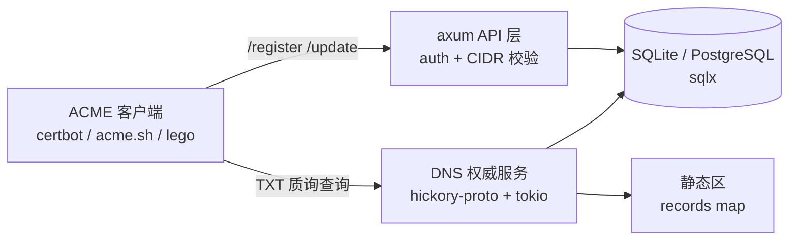

# 架构设计

acme-dns 是单 crate 分层模块应用：axum Web 服务 + hickory-proto 编解码的
自管权威 DNS 服务器 + sqlx（SQLite/PostgreSQL）存储。核心链路为
**DNS 查询 → 内存区 + 存储层查 TXT** 与 **REST API → 存储层 register/update**。

## 总体结构

## 模块划分（src/）

| 模块 | 职责 |
|---|---|
| `main.rs` | 入口：`parse_cli`（init/version/help、`-c`）、启动编排、错误通道、信号处理 |
| `config.rs` | TOML 配置解析/校验/默认值（字段对齐 Go `config.cfg`）、示例配置常量 |
| `logger.rs` | tracing-subscriber 初始化（level / type / format） |
| `error.rs` | `AppError` + `IntoResponse`，对齐 `{"error": "..."}` 错误体 |
| `models.rs` | `AcmeTxt`、`AcmeTxtPost`、`CidrSlice`、配置结构体 |
| `store/` | `Store` trait（register / get_by_username / get_txt_for_domain / update / close）+ SQLite / PostgreSQL 实现 |
| `dnsserver/` | 自管 tokio UDP/TCP 监听、查询应答、静态记录、权威判定、自身质询域 |
| `api/` | axum Router：`/register` `/update` `/health` + 认证 + TLS 启动 |

## DNS 层

- 协议编解码用 `hickory-proto`（RR 解析/序列化、EDNS0、名称压缩）；
  监听层不复用 hickory-server 框架，自己用 tokio 实现 UDP `recv_from`
  循环与 TCP 长度前缀帧。
- 权威判定（`isAuthoritative` / `isOwnChallenge`）与 Go 版同名函数语义一致：
  仅应答本服务 zone 与自身质询子域；未注册子域返回 NXDOMAIN + SOA authority。
- 超时语义对齐 Go 版：DNS 热路径读库 5s，一般操作 20s。

## 存储层

- `Store` trait 抽象四个核心操作；SQLite 实现连接池 `max_connections(1)`，
  复刻 Go 版串行化语义（SQLite 并发写不安全）。
- 双 TXT 滚动更新：每个子域两行，`/update` 写入 `LastUpdate` 最早的一行，
  查询返回两行——CA 两次验证之间旧值仍可答。
- PostgreSQL 后端以 feature flag 提供；`rowid` 语义用显式 `SERIAL` 列等价实现。
- 密码 bcrypt（cost 10）哈希存储，校验用恒定时间比较，防时序侧信道。

## API 层

- axum + tower；`/register` 生成 UUIDv4 用户名/子域 + 40 字符 URL-safe 随机密码，
  事务内写入账户与双 TXT 空行。
- `/update` 校验：`X-Api-User`/`X-Api-Key` 认证 → 子域归属 → `txt` 恰好 43 字符
  → CIDR 来源限制（注册时声明，或经 `use_header`/`header_name` 解析反代头）。
- TLS 三模式：`none`、`cert`（rustls 加载 PEM）、`letsencrypt`（当前未内置
  ACME 客户端，启动时报错提示，见[差异说明](07-compat.md)）。

## 起源与 Go 版的对应关系

本项目最初基于 Go 版 acme-dns 的对外契约重写；下表是当前代码与 Go 包的
模块对应关系，仅作理解起源与行为对照用，不代表后续演进方向。

| Go 版包（上游 joohoi/acme-dns） | Rust 模块（`src/`） |
|---|---|
| `pkg/acmedns`（类型/配置/日志） | `models.rs` `config.rs` `logger.rs` |
| `pkg/database`（SQLite/PostgreSQL） | `store/sqlite.rs` `store/postgres.rs` |
| `pkg/nameserver`（miekg/dns 权威服务） | `dnsserver/`（hickory-proto + 自管 tokio socket） |
| `pkg/api`（httprouter + rs/cors + certmagic） | `api/`（axum + tower + rustls） |
